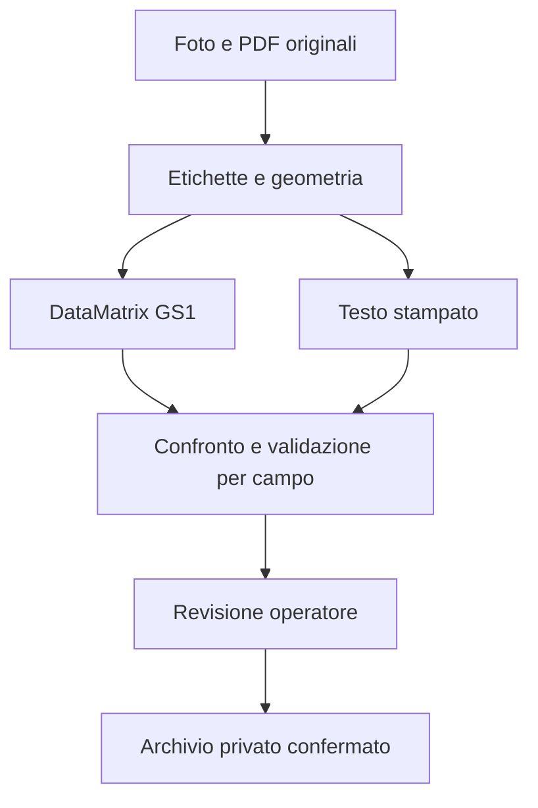

# Modulo etichette degli scarichi operatori

## Architettura

Lettura e validazione sono funzioni Python senza dipendenza dall’interfaccia. Streamlit
e il backend mobile usano lo stesso contratto JSON. L’archiviazione della revisione è
separata sia dal riconoscimento sia dalla transazione di scarico del magazzino.



1. **Acquisizione**: JPG/PNG/WEBP/PDF, più documenti. Il servizio generico valida
   contenuto effettivo, massimo 20 file, 25 MiB per file e 50 MiB totali. Applica EXIF;
   i PDF vengono resi a 288 DPI con limite di 12 pagine per documento.
2. **Geometria**: localizzazione visiva e ancoraggi fisici. Per il layout Synthes
   supportato, bordi misurati, un solo finder per adesivo, orientamento e deskew.
   Altri layout mantengono il percorso visivo/barcode lineari. Rettangoli incerti
   restano espliciti. Il numero automatico non sostituisce il conteggio dell’operatore.
3. **GS1 prima dell’AI**: ZXing decodifica ciascun ritaglio su originale e varianti
   conservative. Si validano GTIN con check digit, AI supportati, lunghezze, date e
   campi variabili. AI (01) è GTIN e **non è REF**. Il REF viene letto dallo stampato;
   non viene derivato da una descrizione o aggiungendo una S.
4. **Verifica incrociata**: due letture visive e controllo locale Tesseract quando
   presente. Se l’AI fallisce, lotto/scadenza GS1 già validati vengono conservati.
   Se testo e GS1 discordano, il campo critico resta da verificare, senza correzione
   silenziosa; entrambe le osservazioni sono accessibili.
5. **Validazione**: ogni campo ha valore, metodo, stato, osservazioni e forza
   dell’evidenza. Quest’ultima è un punteggio tecnico, NON una probabilità calibrata.
   Scadenza ISO; precisione mese esplicita; allarmi scaduto/in scadenza entro 90 giorni
   (configurabile). Confronto opzionale con il catalogo esatto, preservando S/TS.
6. **Revisione**: originale con box, ritagli, campi modificabili, aggiunta manuale
   collegata al documento, conteggio e conferma singola. Stesso REF+lotto aggrega
   quantità 2/3/etc. Scadenze discordanti per lo stesso REF/lotto richiedono verifica.
7. **Conferma**: nessuna scrittura Supabase durante l’analisi. Solo un invio esplicito
   archivia foto originali byte per byte, estrazione non modificata, valori confermati,
   metodi per campo, utente del server e data/ora. Lo scarico resta una transazione
   distinta e già esistente. L’azione di sola archiviazione non muove giacenze.

## File completi

| File | Responsabilità |
|---|---|
| `ocr_service.py` | API Python per più documenti, errori per documento e risultati di revisione |
| `label_pipeline.py` | GS1, decodifica, localizzazione, letture, confronto e immagini con box |
| `label_geometry.py`, `sticker_geometry.py`, `linear_label_geometry.py` | Geometria misurata, orientamento e raddrizzamento |
| `ocr_review.py` | Contratto per campo, date, catalogo, aggregazione e conferma |
| `ocr_repository.py` | Foto originali private, archivio immutabile e ripetizione idempotente |
| `pages/_05_Scarico_Sala_AI_impl.py` | Schermata integrata nella web app esistente |
| `sql/ocr_review_archive.sql` | Tabella, indici, privilegi, RLS, trigger immutabilità e bucket privato |
| `tests/test_ocr_review.py` | Prove GS1/conflitti/date/quantità/conferma/timeout/archivio |
| `tests/ocr_review_archive.sql` | Prove SQL di RLS, privilegi, immutabilità e vincoli |

## Librerie e Render

- `zxing-cpp==2.3.0`: decodifica GS1 con wheel Linux, senza dipendenza obbligatoria
  da libdmtx di sistema. Non servono contemporaneamente due decoder.
- `opencv-python-headless==4.11.0.86`: geometria e preprocessing senza GUI.
- Pillow: EXIF, immagini e validazione. PyMuPDF 1.26.4: PDF.
- OpenAI SDK: OCR visivo strutturato già configurato nel server.
- supabase-py: Storage e database tramite backend autenticato.
- Tesseract inglese: controllo locale aggiuntivo, mai ricostruzione di identificativi.

Le dipendenze principali sono già in `requirements.txt`; il lockfile del container
unificato include ora anche OpenCV. Il `mobile/Dockerfile` installa Tesseract e libgomp
prima di passare all’utente senza privilegi. La build nativa Python di Render può usare
i decoder Python e il ripiego visivo; per Tesseract usare il Dockerfile. Non è necessario
cambiare provider o introdurre un servizio OCR esterno aggiuntivo.

## Uso dal backend, anche per la futura app mobile

```python
from uuid import uuid4
from ai_ocr import analyze_document
from ocr_service import analyze_documents
from ocr_repository import OriginalDocument, SupabaseReviewRepository

# La route deve già verificare il principal e i permessi OrthoFlow.
# Bytes ricevuti dal caricamento, NON percorsi arbitrari inviati dal client.
originals = [OriginalDocument(name=uploaded_name, content=uploaded_bytes)]
review = analyze_documents(originals, analyzer=analyze_document, catalog=catalog_codes)
# Restituire alla UI box, assessment e campi; mantenere review/originals nel backend
# in uno stato isolato per utente, con scadenza. Nessuna scrittura qui.

# In una SECONDA richiesta esplicitamente confermata dall’operatore:
# confirmed_rows devono mantenere gli ID fisici di review e reviewed/verificata=True.
# Per ogni nuova revisione usare un UUID; riusare lo STESSO UUID solo per un retry.
saved = SupabaseReviewRepository(server_supabase).save_confirmed(
    request_id=review_uuid,  # generato dal server con str(uuid4())
    actor=authenticated_principal,  # mai preso dal JSON inviato dal telefono
    extraction=review, confirmed=confirmed_rows, documents=originals,
    physical_count=operator_count, count_verified=operator_count_verified,
    explicitly_confirmed=True,
)
```

Il contratto non dipende da Streamlit. La route mobile deve mantenere l’estrazione
originale in stato server autenticato, autorizzare ogni accesso e applicare rate/byte
limits. Non accettare come attendibili estrazione, utente o percorsi contenuti nel
body del client. La UI mobile corrente riceve i campi tramite l’analizzatore condiviso;
la nuova schermata mobile di conferma non viene dichiarata completata da questo lavoro.

## Tabella e attivazione

Eseguire **prima in staging** l’intero file `sql/ocr_review_archive.sql`. La tabella
`ocr_review_sessions` contiene una revisione completa in una sola riga atomica:
UUID, utente, timestamp, versione pipeline, hash del payload, manifest foto, estrazione,
conferma, righe aggregate e conteggio verificato. Immagini e data URL non sono duplicati
nel JSON. Ogni originale sta nel bucket privato `scarico-ocr-originals`, con SHA-256.

Il progetto usa autenticazione e autorizzazione nel proprio backend Python, perciò la
nuova tabella è server-only: RLS attiva, nessun privilegio per anon/authenticated,
SELECT/INSERT al servizio server. Il trigger impedisce UPDATE/DELETE anche in caso di
grants futuri. La service key non va mai inviata al browser o incorporata nell’app mobile.

Dopo verifica tabella, bucket e permessi, impostare nel server:

```toml
OCR_REVIEW_ARCHIVE_ENABLED = "true"
```

L’impostazione è disattivata per default, così l’assenza della tabella nuova non rompe
lo scarico esistente. Quando attiva, compare l’azione «Conferma e archivia revisione OCR
(senza scarico)»; l’invio «Crea intervento e scarica materiali» archivia prima la revisione.
Se l’archivio fallisce, non parte lo scarico e i campi della sessione restano disponibili.
L’audit già presente nella transazione di scarico include comunque dati estratti e
confermati; il nuovo archivio aggiunge gli originali immutabili e l’idempotenza dedicata.

La lista scanner `codici_prodotto_scan` viene usata come confronto disponibile, ma può
essere incompleta: assenza segnala verifica, non inventa né sostituisce un REF. Per un
catalogo completo passare l’insieme autorevole a `build_review`/`analyze_documents`.

## Errori e ripetizioni

Storage e Postgres non condividono una transazione distribuita. I file sono caricati
con percorsi unici e senza overwrite solo dopo conferma. Un timeout può lasciare foto
senza riga archivio: il retry con lo stesso UUID verifica i byte e completa l’inserimento.
Non si cancellano foto o si ripete lo scarico per dedurre l’esito di un timeout.
Una revisione già salvata con lo stesso UUID e stesso contenuto viene restituita;
un contenuto diverso richiede una nuova revisione. Applicare un’eventuale politica di
pulizia degli orfani separatamente, dopo riconciliazione, senza cancellazioni automatiche.

Foto tagliate, riflessi o dati illeggibili possono impedire la lettura fedele: il sistema
mantiene campi vuoti, avvisi e controllo fisico. Gli esiti non equivalgono a una garanzia
che ogni etichetta sia stata trovata. Se manca una parte del testo occorre una foto migliore.

## Collaudo

```bash
python -m pytest tests/test_ocr_review.py tests/test_label_pipeline.py tests/test_label_geometry.py tests/test_literal_evidence_conflicts.py
python -m compileall -q ocr_review.py ocr_repository.py ocr_service.py label_pipeline.py
# In database temporaneo locale/CI, MAI con credenziali di produzione:
bash tests/run_database_tests.sh
```

I test verificano due/tre pezzi identici, lotti distinti, scadenze discordanti, campo
non leggibile, GS1 non valido, barcode valido con AI in errore, sette etichette inclinate
in quattro orientamenti, assenza di scritture senza conferma, originali invariati,
manual correction, retry e timeout dopo commit. I mock validano orchestration/contratti,
non l’accuratezza del modello. Per il collaudo finale serve il modello live configurato
nel server e confronto di ogni REF/lotto/scadenza su foto/PDF rappresentativi; una CI verde
non sostituisce questa prova. La migrazione nuova non è applicata alla produzione da questo lavoro.


## Attivazione archivio prodotto (16 ottobre 2026)

La pagina usa ora `save_product_review`: nessun documento completo viene letto o
caricato nell'archivio. Si conservano solo ritagli delle etichette già passati dal
filtro privacy, ricodificati senza metadati, e campi prodotto selezionati. Intestazioni,
nomi file, metadati clinici e regioni scartate non entrano nel payload. Il bucket
resta privato e la tabella immutabile, accessibile solo al servizio server.
Questa modalità sostituisce le indicazioni sugli originali completi riportate sopra.

`OCR_REVIEW_ARCHIVE_ENABLED` è ora true per default; false consente il rollback.
La migrazione consente revisioni solo manuali senza immagini e conteggi discordanti.
Sono registrati valori estratti, valori confermati e log di aggiunte/modifiche/eliminazioni
con utente, timestamp e metodo. Il retry della stessa revisione non duplica i dati.
L'archiviazione non esegue scarichi e non salva automaticamente quanto non confermato.
